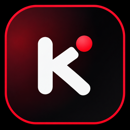

<div align="center">



# Kairo

**Seu sistema de vida para Windows e Linux.**

Rotina, estudos, finanças, metas e os serviços que você acompanha, reunidos em um só lugar e cuidados por um time de agentes com personalidade própria.


-0b0d10?style=flat-square)


<br />

<a href="midia/comercial.mp4">
  
</a>

<sub>Clique na imagem para assistir ao comercial.</sub>

</div>

---

Este README descreve o código atual do repositório. Algumas mudanças podem ainda não estar no instalador da última release. Para saber o que foi distribuído, consulte as [releases](https://github.com/henriquehawks/kairo/releases).

## Sobre

O Kairo é um aplicativo desktop que fica junto do sistema, e não dentro de uma aba do navegador. Ele roda no Windows 10 e 11 e no Linux (Ubuntu e Fedora com GNOME). Este README descreve a versão do Windows; o que muda no Linux está no [README-linux](README-linux.md). Ele aparece em três camadas:

| Camada | Onde fica | Para que serve |
| ------ | --------- | -------------- |
| **Ilha** | Topo da tela | Mídia tocando, pomodoro, tarefas do dia, captura rápida e avisos do time |
| **Dock** | Base da tela | Iniciar do Windows, busca de aplicativos, janelas abertas, prévias e menus de contexto |
| **Sistema** | Janela própria | Início, chat, agentes, finanças, estudos, metas, calendário e configurações |

<p align="center">
  
</p>

<p align="center">
  
</p>

Três princípios guiam o projeto:

- **Funciona sem IA.** Toda função principal tem um caminho próprio. A IA é uma camada opcional que melhora o que já funciona.
- **Você escolhe o provedor.** Cada pessoa conecta o provedor e o modelo que quiser, com a própria chave, ou usa um modelo local.
- **Armazenamento local.** Os registros do app ficam no seu computador e as credenciais das conexões ficam no Gerenciador de Credenciais do Windows. Não é necessário criar uma conta do Kairo. Integrações consultam serviços externos e, ao usar IA, mensagens e contexto necessário podem ser enviados ao provedor escolhido. Local não significa que todos os recursos funcionam sem internet.

## Funcionalidades

### Ilha

Uma barra discreta no topo da tela, com três estados: escondida, compacta e expandida. As abas são configuráveis:

- **Hoje:** calendário, tarefas, hábitos e próximos compromissos, conforme as seções habilitadas. A entrada de tarefas aceita linguagem natural ("ligar pro banco 15h").
- **Mídia:** reprodução informada pelo Windows, com capa, controles, progresso e volume do sistema, incluindo porcentagem e botão de silenciar.
- **Foco:** pomodoro com etapas de foco e pausa.
- **Chat:** conversa rápida com o time, com anexos.
- **Conexões:** números e últimas atividades de cada serviço, como cobranças do Stripe, contribuições e commits do GitHub, e-mails do Resend e tráfego do Cloudflare.
- **Avisos:** os alertas do time.
- **Time:** seleção de agente, identidade e guarda-roupa, com prévias dos acessórios e escolha de cor.
- **Código:** acompanhamento das sessões de ferramentas de programação, com atividade, alterações e pedidos de aprovação nas ferramentas compatíveis.

<table>
  <tr>
    <td width="50%"></td>
    <td width="50%"></td>
  </tr>
  <tr>
    <td align="center"><sub>Hoje: agenda, tarefas e hábitos</sub></td>
    <td align="center"><sub>Time: identidade e guarda-roupa</sub></td>
  </tr>
  <tr>
    <td colspan="2"></td>
  </tr>
  <tr>
    <td colspan="2" align="center"><sub>Foco: pomodoro com etapas de foco e pausa</sub></td>
  </tr>
</table>

A captura rápida permite registrar tarefa, gasto, link, nota ou lembrete sem abrir uma área completa.

Na área de trabalho, a ilha pode mostrar uma **aba de cada lado**, ligadas por uma faixa fina no topo. Com um app na frente, as laterais ficam escondidas em repouso; ao expandir a ilha, elas podem reaparecer. Essa barra completa é opcional.

- **Esquerda:** personalização (tema, cor de destaque, cor e opacidade da ilha e do dock, tamanho e repouso da ilha), o Iniciar do Windows e as tarefas do dia.
- **Direita:** os apps em segundo plano (os ícones da bandeja do Windows), Wi-Fi, volume, bateria e um painel de controles rápidos, com Wi-Fi e Bluetooth, não perturbe, mudo, microfone, captura de tela, teclado virtual, modo escuro, volume de cada app, brilho, mídia e energia.

Modos **fixo**, **esconder** e **inteligente**. Durante jogos, vídeos em tela cheia e apresentações, a ilha e o dock somem por completo. O **modo privacidade** esconde valores e textos sensíveis quando você compartilha a tela.

Os avisos habilitados podem revelar temporariamente a ilha e mostrar a mensagem antes de restaurar o estado anterior. O comportamento respeita as categorias de aviso e o Não perturbe. A compacta destaca mídia somente durante reprodução ativa; uma faixa pausada continua acessível na aba Mídia.

O fechamento automático oferece 0,5, 1, 2 e 3 segundos, além dos intervalos maiores, **Nunca** e **Ao sair com o cursor**. A ilha fixada, os controles das laterais em uso e os campos em edição impedem o fechamento automático. Time e Código não fecham por temporizador, mas respeitam a opção explícita de fechar ao sair com o cursor.

### Dock

Substitui a barra de tarefas do Windows com acesso ao Kairo, ao Iniciar, à busca e aos aplicativos abertos. Ao passar o mouse, mostra prévias das janelas, de onde dá para focar ou fechar. Também tem os modos fixo, esconder e inteligente.

- **Vários monitores:** pode aparecer em cada monitor ou apenas no escolhido, com organização dos apps conforme a configuração.
- **Perfis de navegador:** separa janelas do Chrome e do Edge quando o Windows fornece identificação do perfil.
- **Botão direito:** menu para mostrar, minimizar e fechar janelas do grupo, além de acessos como Gerenciador de Tarefas e configurações do dock. Fechar todas exige confirmação e o programa pode pedir para salvar arquivos.
- **Lupa:** procura aplicativos e janelas, oferece controles rápidos do Windows, calculadora e pesquisa pelo buscador escolhido. A pesquisa abre o navegador, não dá ao chat uma ferramenta de navegação web.
- **Botões opcionais:** mostre ou esconda a lupa e o Iniciar separadamente pelo menu do dock ou em Ajustes. A escolha fica salva; esconder a lupa não desativa seu atalho nem o acesso à busca pelo menu.

### AtalhoTouch

Um botão flutuante opcional, desativado por padrão, para abrir os aplicativos que você escolher. Pode ser ativado ou desativado pela lupa do dock.

- Arraste o botão para posicioná-lo na tela.
- Uma gaveta compacta revela os atalhos e abre para cima quando não há espaço abaixo.
- Use **+** para adicionar aplicativos, com animação de entrada e aparência combinando com a ilha e o dock.
- Clique com o botão direito em um atalho para removê-lo. Isso não desinstala o aplicativo.

### Sistema

| Área | O que faz |
| ---- | --------- |
| **Início** | Painel do dia com blocos configuráveis: time, tarefas, foco, finanças, revisões e conquistas |
| **Chat** | Conversa com os agentes, com comandos que funcionam mesmo sem IA |
| **Escritório** | Time em uma sala 3D ou modo leve 2D, com estados, tarefa atual, últimas atividades e acesso ao chat |
| **Agentes** | Página própria para editar nome, cor, formato, persona e acessórios de cada integrante |
| **Journal** | Tarefas, hábitos, humor, notas e calendário do dia, com desfazer e refazer |
| **Estudos** | Áreas e matérias, páginas e subpáginas, quadro, provas, links, arquivos locais e revisão espaçada |
| **Finanças** | Contas, cartões, transações, orçamento, recorrentes, metas de economia, divisão de contas, lista de compras e relatórios |
| **Metas** | Pilares de vida, metas medidas por hábitos, horas de estudo, economia ou tarefas, e quadro de visão |
| **Calendário** | Vistas de mês, semana e agenda, recorrências, edição por ocorrência, movimentação de eventos, marcação de feito e importação/exportação ICS |
| **Conexões** | Stripe, GitHub, Vercel, Resend, Notion, Cal.com, n8n, Supabase e Cloudflare, com painéis próprios. Google Workspace desativado, em testes |
| **Provedores de IA** | Escolha do provedor e do modelo, com chave guardada no cofre do Windows |
| **Consumo de IA** | Uso e limites das ferramentas de IA que você usa |
| **Conquistas** | Marcos e mapa de calor da sua rotina |
| **Configurações** | Aparência, ilha, dock, sons, atalhos, privacidade, backup e dados |
| **Atualização** | Versão instalada, verificação de atualizações, novidades e links do projeto |

A janela principal recebeu uma atualização visual e paginação nas listas longas. Áreas e funções opcionais podem ser desativadas nas configurações.

<table>
  <tr>
    <td width="50%"></td>
    <td width="50%"></td>
  </tr>
  <tr>
    <td align="center"><sub>Journal</sub></td>
    <td align="center"><sub>Finanças</sub></td>
  </tr>
  <tr>
    <td width="50%"></td>
    <td width="50%"></td>
  </tr>
  <tr>
    <td align="center"><sub>Estudos</sub></td>
    <td align="center"><sub>Calendário</sub></td>
  </tr>
</table>

### Calendário e arquivos

Eventos recorrentes podem ser editados ou excluídos somente em uma ocorrência ou em toda a série. Hábitos com horário aparecem no calendário e podem gerar lembretes enquanto não forem cumpridos.

A importação `.ics` interpreta horários UTC e fusos `TZID` reconhecidos pelo sistema, convertendo data e hora para o fuso do computador. Eventos de dia inteiro permanecem sem horário; horários sem fuso são mantidos como locais. Não é uma sincronização contínua com o Google e não corrige retroativamente registros importados antes da correção. Fusos personalizados e todas as possibilidades de recorrência do formato ICS não são suportados integralmente.

Arquivos de Estudos ficam no computador e podem ser abertos no programa associado. A leitura de texto para o chat admite PDF, documentos compatíveis do Office e imagens com OCR do Windows, sujeito a limites e à disponibilidade do OCR. A extração pode conter erros.

### Google Workspace e outras conexões

**Google Workspace está desativado (em testes).** O código contém a implementação de Gmail, Agenda, Drive e Google Tasks, mas login, consultas, criação de rascunhos e envio de e-mails estão bloqueados nesta versão do código, inclusive nas ferramentas do chat. Configurações antigas não reativam a integração. Credenciais já armazenadas não são apagadas automaticamente. Não há uma data anunciada para disponibilização.

No GitHub, os painéis distinguem pull requests próprios e pedidos de revisão, com status de CI por PR quando disponível. A ilha e a janela completa também mostram o calendário de contribuições do último ano e commits recentes, com detalhes e links quando fornecidos pela API. As contribuições representam a atividade informada pelo GitHub, não apenas commits.

As demais conexões dependem das permissões, credenciais e limites do respectivo serviço.

### Ferramentas de código na ilha

A aba Código integra Claude Code, Codex, Copilot CLI, OpenCode, Antigravity, Kimi, Gemini CLI e Amp. A configuração é feita pelo Kairo, com acompanhamento local dos eventos disponíveis em cada ferramenta.

- Sessões identificadas por projeto e ferramenta, passos recentes e alterações de arquivos quando informadas.
- Pedidos de aprovação nas integrações compatíveis, atualmente Claude Code, Codex e Copilot. A integração com Claude também apresenta perguntas com opções para resposta.
- Acesso ao terminal e ao projeto da sessão, sem transformar o chat comum em um controlador irrestrito do Windows.
- Indicadores de uso de Claude e Codex quando a fonte fornece esses dados. Ausência de informação não equivale a consumo zero.
- Resumo semanal local de sessões, comandos, alterações e pedidos registrados. Esses números representam eventos acompanhados pelo Kairo, não uma auditoria completa de toda a atividade do computador.

As capacidades variam entre ferramentas e versões. Uma integração que acompanha atividade não necessariamente permite aprovar comandos, responder perguntas ou enviar instruções.

### O time

| Agente | Cargo | Cuida de |
| ------ | ----- | -------- |
| **Rubi** | Gerente de projetos | Rotina, tarefas, hábitos, agenda e metas |
| **Nanquim** | Professor | Estudos, revisões e provas |
| **Sol** | Analista de operações | Finanças, orçamento e consumo de IA |
| **Java** | Engenheiro de software | Código, repositórios, pull requests e conexões |

<p align="center">
  
</p>

<p align="center">
  
</p>

Cada agente tem oito estados visíveis (ocioso, ouvindo, pensando, escrevendo, sucesso, alerta, erro e dormindo) e reage ao que está acontecendo de verdade no app.

O visual inicial usa quatro estrelas nas cores vermelha, verde, amarela e azul. Na página **Agentes** ou na aba **Time** da ilha, é possível personalizar nome, cor e formato usando os moldes existentes, sem trocar a função do integrante. As escolhas ficam salvas localmente. A persona é opcional, não concede permissões extras e não substitui os comandos que funcionam sem IA.

O **guarda-roupa** tem 27 acessórios e permite vestir **um por vez**, com sua cor original ou uma cor escolhida. Há lacinho, fone, boina, boné, coroa, óculos, colar e opções de Halloween e Natal. Também inclui chapéus de chef, cowboy e pirata, cartola, tiaras de flores e gatinho, monóculo, bandana, asas e mochila. A capa tem pregas e acabamento dourado. As prévias mantêm a cor e o formato do personagem; os acessórios acompanham os quadros das animações do corpo. A troca tem uma transição com fumaça e respeita a preferência de movimento reduzido.

## Atalhos

Combinações globais padrão, configuráveis no app. Conflitos com atalhos de outros programas são informados quando detectados.

| Atalho | Ação |
| ------ | ---- |
| `Ctrl` `Alt` `Espaço` | Captura rápida |
| `Ctrl` `Alt` `L` | Lupa de aplicativos do dock |
| `Ctrl` `Alt` `N` | Abrir ou esconder o sistema |
| `Ctrl` `Alt` `P` | Iniciar ou pausar o pomodoro |
| `Ctrl` `Alt` `M` | Tocar ou pausar a mídia |
| `Ctrl` `Alt` `H` | Modo privacidade |
| `Ctrl` `K` | Busca global e comandos |
| `Ctrl` `N` | Novo item na área atual |
| `Ctrl` `B` | Recolher ou expandir a barra lateral |
| `Ctrl` `1` a `Ctrl` `9` | Ir para as áreas da barra lateral |
| `Esc` | Fechar modal, painel ou ilha |

As ações globais de Não perturbe, próximo pedido de aprovação, próxima aba e terminal podem receber combinações próprias nas configurações. Atalhos internos, como `Ctrl K`, dependem da janela em foco.

## Recursos do chat

O pomodoro, a lista de capacidades e o relatório semanal funcionam sem provedor de IA:

- `/pomodoro 25` inicia o foco, sem sobrescrever uma sessão existente.
- `/pomodoro pausar`, `/pomodoro continuar` e `/pomodoro encerrar` controlam a sessão atual. Encerrar registra somente os minutos utilizados e não inicia outra etapa.
- `/pomodoro status` consulta o estado e o tempo restante real.
- `/capacidades` lista as ferramentas cadastradas, respeitando as permissões e conexões atuais. Não comprova que o modelo escolhido aceita ferramentas.
- `/relatorio` calcula os últimos sete dias a partir dos registros locais. Não inclui finanças e não preenche dias sem registro.

Anexos analisáveis têm ações para resumir, explicar, criar perguntas e extrair texto. A extração é local; as análises por IA usam o provedor escolhido. Documentos têm limite de 30 MB por arquivo, outros anexos de 8 MB, e cada mensagem admite até quatro anexos. Textos extraídos podem ser recortados antes da análise. OCR reconhece texto, mas interpretar visualmente uma imagem exige um modelo com visão.

As ferramentas do chat podem consultar registros e conexões autorizadas, inclusive arquivos de Estudos. A disponibilidade depende das funções habilitadas, das permissões e do suporte do modelo. O chat do Kairo ainda não tem uma ferramenta própria de pesquisa na internet.

Perguntas sobre Cloudflare e Supabase são encaminhadas ao Java. Menções explícitas continuam escolhendo o agente. Confirmações e resultados de ações vêm das ferramentas, sem anunciar um cartão pendente como salvo. As respostas do modelo são verificadas antes de aparecer, mas isso não elimina todos os possíveis erros de uma IA.

## Privacidade, limites e segurança

- Modelos podem errar. Confirmações de ferramentas ajudam a evitar respostas falsas sobre ações executadas, mas não eliminam alucinações.
- Integrações e análises por IA podem transmitir dados ao serviço escolhido. Revise o contexto e evite anexar segredos ou informações que não deseja compartilhar.
- Importações, backups e registros passam por validações de formato e referências. Isso não substitui manter seus próprios backups.
- Não publique chaves, tokens, arquivos de configuração com segredos ou dados pessoais em issues. Para relatar um problema, informe versão do Kairo, versão do Windows, passos para reproduzir e uma captura anonimizada.
- O Escritório tem duas áreas: time Kairo e Escritório de IAs. A área de IAs organiza sessões recebidas em salas por projeto, com personagens pixelados, atividade filtrável, detalhes por sessão, renomeação visual, câmera e análises locais por hora, projeto e ferramenta. Usa as mesmas conexões e pedidos do modo Código da ilha. Tarefas, subagentes, contexto e estimativas de custo aparecem somente quando a ferramenta fornece os dados correspondentes. O botão de terminal traz uma sessão existente, não cria um terminal interativo dentro do escritório.

## Tecnologias

| Camada | Tecnologia |
| ------ | ---------- |
| Desktop | Tauri 2 e Rust, com APIs nativas do Windows e equivalentes do Linux |
| Interface | React 19, TypeScript e Vite |
| Animações | Motion e Three.js |
| Estado | Zustand |
| Ponte local | Node, empacotado junto com o app |

## Download

Baixe somente pelas [releases oficiais deste repositório](https://github.com/henriquehawks/kairo/releases). Este README descreve o código atual; confira as notas da release para saber quais recursos estão no instalador.

| Sistema | Arquivo | Atualização |
| ------- | ------- | ----------- |
| **Windows 10 e 11** | `Kairo_x.y.z_x64-setup.exe` | Automática, pelo próprio app |
| **Ubuntu e Debian** | `Kairo_x.y.z_amd64.deb` | Manual: baixe o pacote novo e instale por cima |
| **Fedora** | `Kairo-x.y.z-1.x86_64.rpm` | Manual |
| **Outras distribuições** | `Kairo_x.y.z_amd64.AppImage` | Manual |

O `.msi` do Windows fica nas releases só para quem já instalou por ele.

### Linux

A versão para Linux foi feita para GNOME e está em teste. O Node já vem dentro do pacote. Alguns recursos do Windows ainda não existem no Linux, como as prévias das janelas no dock e a detecção de tela cheia, e outros dependem de programas do sistema, como `playerctl` para a mídia e `tesseract` para o OCR. A lista completa, com os comandos de instalação, está no [README-linux](README-linux.md).

```bash
sudo apt install ./Kairo_*_amd64.deb     # Ubuntu e Debian
sudo dnf install ./Kairo-*.x86_64.rpm    # Fedora
```

### Windows Defender e SmartScreen

Um aviso do SmartScreen de **aplicativo não reconhecido** pode acontecer quando um arquivo ainda não tem reputação suficiente. Esse aviso, sozinho, não significa que o Kairo tem um vírus ou um erro de funcionamento, conforme a [documentação da Microsoft](https://learn.microsoft.com/en-us/windows/apps/package-and-deploy/smartscreen-reputation).

Isso é diferente de uma **detecção de ameaça pelo Defender**. Não tratamos toda detecção como falso positivo. Se uma ameaça for identificada, interrompa a instalação, mantenha a proteção ativa e relate a versão, o nome da detecção e a origem do download, sem incluir dados pessoais. Não é necessário nem recomendado desativar o antivírus ou criar exclusões para usar o Kairo. Um aviso suspeito pode ser [enviado à Microsoft para análise](https://learn.microsoft.com/en-us/windows/security/operating-system-security/virus-and-threat-protection/microsoft-defender-smartscreen).

## Como rodar

### Requisitos

- Windows 10 ou 11
- Node 22 ou mais novo e pnpm
- Rust estável, para a versão desktop
- WebView2, que já vem no Windows 11

Para compilar e rodar no Linux, siga o [README-linux](README-linux.md).

### Interface no navegador

```powershell
pnpm install
pnpm dev
```

Abra o endereço que aparecer no terminal (por padrão `http://localhost:5420`). Essa execução serve para desenvolvimento e não equivale ao aplicativo instalado: recursos nativos dependem do Windows, da ponte local e, em alguns casos, do ambiente desktop do Tauri.

### Versão desktop

```powershell
pnpm install
pnpm ponte:build
pnpm dev
```

Com o `pnpm dev` aberto, em outro terminal:

```powershell
pnpm tauri dev
```

### Outros comandos

```powershell
pnpm verificar   # checagem de tipos em modo estrito
pnpm test        # todos os testes isolados, executados em sequência
pnpm build       # build da interface em dist/
pnpm chat:testar # testes do chat com provedor falso, sem rede ou banco real
pnpm midia:testar # testes de mídia pausada e consultas fora de ordem
pnpm app         # gera o instalador do Windows
pnpm versao      # sincroniza o número da versão nos arquivos, sem buildar
pnpm notas       # rascunha as notas da versão a partir dos commits
pnpm publicar    # confere, sincroniza, commita e cria a tag que publica a release
```

### Publicar uma nova versão

Empurrar a tag publica a release sozinho. Commitar não publica nada: o workflow [Publicar versão](.github/workflows/publicar.yml) só roda com uma tag `v*` ou pelo botão Run workflow no GitHub. São dois comandos, com a 0.2.8 de exemplo:

```powershell
pnpm notas 0.2.8       # rascunho das notas a partir dos commits desde a última tag
# reescreva os textos pensando em quem usa o app
pnpm publicar 0.2.8    # confere, sincroniza, commita, empurra e cria a tag
```

**`pnpm notas 0.2.8`** lê os commits desde a última tag, separa `feat:`, `fix:` e `perf:` em Novidades, Correções e Melhorias, e escreve os dois lugares de uma vez: o arquivo `docs/releases/0.2.8.md` e a entrada do histórico em `src/textos/textos.ts`, que vira a página Novidades dentro do app. O texto sai cru, com o assunto de cada commit — reescreva as duas cópias com as frases que o usuário vai ler. Use `--refazer` para sobrescrever um rascunho já existente.

**`pnpm publicar 0.2.8`** só vai até o fim se tudo estiver no lugar. Antes de tocar em qualquer arquivo, ele recusa quando:

- você não está na `main`;
- existe arquivo modificado que não seja da própria versão (as notas, o `textos.ts` e os arquivos de versão são os únicos aceitos — o resto você commita antes);
- faltam as notas em `docs/releases/0.2.8.md`, elas têm menos de 200 caracteres, ou não começam com `# Kairo 0.2.8`;
- sobrou trecho de rascunho entre `<` e `>` no texto, em qualquer um dos dois arquivos;
- falta a entrada da versão no histórico de `src/textos/textos.ts`;
- a tag `v0.2.8` já existe aqui ou no GitHub, ou a release já foi publicada;
- a versão é menor que a atual.

Passando nas checagens, ele roda `pnpm verificar` e `pnpm test`, sincroniza a versão nos quatro arquivos e no selo deste README, cria o commit `chore: versão 0.2.8`, empurra a `main`, cria a tag `v0.2.8` e empurra a tag — que é o que dispara o workflow. No fim imprime o link do Actions.

- `pnpm publicar 0.2.8 --ensaio` faz todas as checagens e mostra o que faria, sem alterar nem empurrar nada.
- `pnpm publicar 0.2.8 --sem-testes` pula tipos e testes, para quando você acabou de rodá-los.

Um teste em `scripts/interface.test.mjs` cobre a mesma regra pelo lado de dentro: a versão de `package.json` precisa ter notas em `docs/releases/`, com o título certo, e ser a primeira entrada do histórico, com data no formato `AAAA-MM-DD` e tipos conhecidos (`novo`, `melhoria`, `correcao`). Assim o esquecimento aparece no `pnpm test`, e não no workflow depois do push — onde consertar custa apagar a tag e a release.

Os dois buildes rodam **ao mesmo tempo**: o do Windows gera o `.exe`, o `.msi` e o `latest.json` assinados, o do Linux gera o `.deb`, o `.rpm` e o AppImage, cada um guardando os arquivos como artefato. Só então o último job cria a release com os seis de uma vez. São ~13 minutos no total.

Isso é tudo ou nada: se qualquer um dos dois buildes falhar, release nenhuma é criada, e você corrige e empurra a tag de novo (apagando a anterior). O build do Windows roda só a checagem de tipos, porque os testes já passaram no `pnpm publicar` e no workflow Verificar do push.

Quem já tem o Kairo recebe a atualização sozinho a partir daí, porque o app lê o `latest.json`.

#### Fazendo na mão

Os mesmos passos, se precisar de controle fino:

```powershell
pnpm verificar
pnpm test
pnpm versao 0.2.8                  # grava a versão nos quatro arquivos e no selo do README
git commit -am "chore: versão 0.2.8"
git push origin main
git tag v0.2.8 ; git push origin v0.2.8
```

A tag precisa ser `v` seguido da mesma versão dos arquivos, senão o workflow para. Para repetir a mesma versão depois de um erro, apague antes a release e a tag — há uma trava contra release duplicada:

```powershell
gh release delete v0.2.8 --repo henriquehawks/kairo --yes
git push origin :v0.2.8
git tag -d v0.2.8
```

#### Buildar e assinar no seu computador

`pnpm lancar` faz a mesma sincronização e segue para o build assinado, sem publicar nada:

```powershell
pnpm lancar 0.2.7 --notas-arquivo docs/releases/0.2.7.md
```

O instalador e a assinatura precisam existir com o nome esperado e ter sido gerados no build atual; só depois é escrito o `latest.json`, em `src-tauri/target/release/bundle/nsis`. Use sempre a mesma chave de atualização das versões anteriores: o script usa `TAURI_SIGNING_PRIVATE_KEY` ou a chave em `%USERPROFILE%\.tauri\kairo-atualizacao.key`, e no workflow ela vem do secret do repositório. Se ela tiver senha, configure `TAURI_SIGNING_PRIVATE_KEY_PASSWORD`. Nunca publique a chave privada.

Comandos que não geram instalador:

```powershell
pnpm versao
pnpm versao 0.2.7 --verificar
pnpm lancar:verificar
pnpm lancar 0.2.7 --verificar
pnpm lancar:testar
```

Os dois primeiros mostram a versão atual e a prévia da sincronização. O terceiro e o quarto fazem o mesmo pelo `pnpm lancar`. O último executa os testes das proteções de release. Para reconstruir de propósito uma versão já publicada, use `--recompilar`: ela dispensa a consulta de duplicidade, mas mantém as validações dos arquivos e do build. Não substitua uma release publicada com esses arquivos.

## Estrutura

```text
src/
  janelas/        área de trabalho, ilha, dock e janela do sistema
  modulos/        uma pasta por área do sistema
  componentes/    botões, campos, modais, editor e gráficos
  personagens/    personagens do time e suas animações
  estado/         stores de cada área
  ponte/          comunicação com o lado nativo
  servicos/       lembretes, pomodoro, recorrentes, orçamento e conquistas
  textos/         todos os textos da interface
  utilitarios/    datas, dinheiro, comandos e sanitização
servidor/         ponte local: banco, credenciais, mídia, janelas e conexões
src-tauri/        app desktop em Rust
scripts/          build da ponte, personagens e lançamento de versões
public/           personagens e sons
```

## Licença

Copyright (c) 2026 [Henrique](github.com). Todos os direitos reservados.

